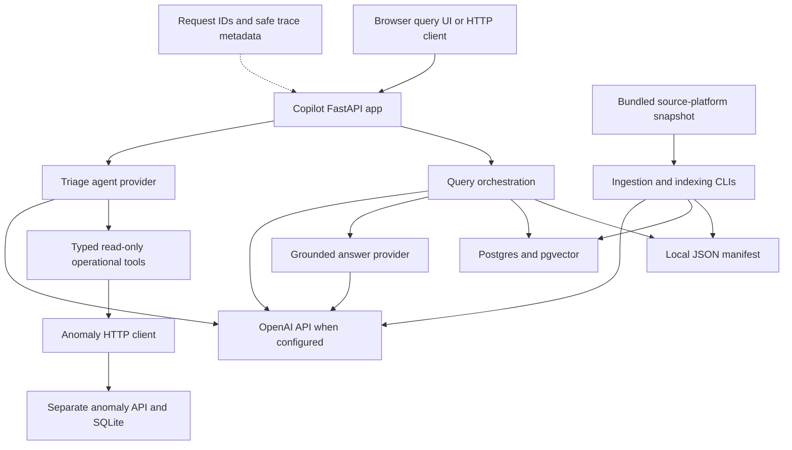

# 2. Architecture and repository map

[Handbook index](README.md) · Previous: [Getting started](01-getting-started.md) · Next: [Data pipelines](03-data-pipelines.md)

## System boundaries



The application combines two workflows rather than one universal agent. Query answering retrieves text; operational triage reads live records through tools. Provider protocols allow deterministic and OpenAI implementations. The same `ai_provider` setting selects both workflows' providers, while `retrieval_backend` chooses manifest or pgvector independently.

## Responsibilities and direction of dependencies

| Layer | Responsibility | Main dependencies |
| --- | --- | --- |
| `api` | Construct services, validate HTTP requests, map failures, serve static UI, attach request IDs | Query service, provider factories, storage/session factory, operational client/tools |
| `ingestion` | Discover text, retain provenance, split line windows, read/write manifests | Source and chunk schemas; filesystem |
| `retrieval` | Rank source chunks, format context, build citations | Hash vectors or embedding protocol plus SQLAlchemy/pgvector |
| `answering` | Empty/low-score refusal gate and generator dispatch | Grounded-answer provider protocol |
| `providers` | Embedding, answer and triage implementations, factories and typed errors | Schemas, OpenAI client, operational tools; deterministic triage service |
| `services` | Rule-based triage workflow | Typed tools and operational/report schemas |
| `clients` / `tools` | HTTP transport and schema/error adaptation for upstream reads | httpx, Pydantic, anomaly API |
| `storage` | Vector-table definition, initialization, upsert and complete replacement | SQLAlchemy, psycopg, pgvector |
| `schemas` | Shared source, retrieval, answer, operational and report shapes | Pydantic |
| `evals` | Case loading, contract checks and quality aggregation | Query/triage callable interfaces and evaluation schemas |
| `observability` | Trace correlation, timing and safe serialization | Python logging and context variables |
| `static` | Same-origin query form and response/context display | Browser APIs; no frontend dependency/build pipeline |

The factory injects adapters rather than importing route logic into providers. CLIs reuse ingestion, retrieval, storage, and evaluation functions. Tests inject transports/clients or replace callables at those boundaries. A provider method returning a valid Pydantic model does not automatically prove semantic correctness; orchestration and provider code implement additional checks.

The browser posts `{query, show_context: true}` to `/query`, displays answer or refusal, confidence, citations, context and request ID, and disables the submit button while awaiting a response. It builds response text with `textContent`; it is not a general Markdown renderer. There is no triage UI, streaming answer protocol, or conversation history.

## Annotated layout

```text
anomalyops-copilot/
├── copilot/                    Application package
│   ├── api/                    App factory, routes, settings, query orchestration
│   ├── answering/              Grounded-answer threshold/refusal gate
│   ├── clients/                HTTP adapter for the anomaly platform
│   ├── evals/                  Evaluation schemas and scoring logic
│   ├── ingestion/              Discovery, chunking, manifest serialization
│   ├── providers/              Protocols, factories, deterministic/OpenAI adapters
│   ├── retrieval/              Hash/pgvector ranking and citation/context helpers
│   ├── schemas/                Public and internal Pydantic contracts
│   ├── services/               Deterministic operational triage workflow
│   ├── static/index.html       Standalone browser query UI
│   ├── storage/                SQLAlchemy models and database writes
│   ├── tools/                  Four typed operational tools
│   └── observability.py        Request-ID context and JSON trace events
├── data_sources/anomaly_detection_platform/
│   ├── source_code/            Reference ML/API/dashboard implementation
│   ├── tests/                  Reference platform tests; not root pytest targets
│   └── workflows/              Reference platform CI
├── scripts/                    Ingestion, storage, retrieval, evaluation, demo CLIs
├── tests/                      Copilot suite, including integration/ subdirectory
├── evals/                      Labeled cases and historical semantic results
├── docs/                       Screenshot, earlier fix list, this handbook
├── .github/workflows/ci.yml    Copilot CI
├── .env.example                Example live configuration
├── Dockerfile                  Offline API image and build-time ingestion
├── docker-compose.yml          API plus persistent local Postgres
└── pyproject.toml              Packaging, dependencies, pytest and Ruff settings
```

Ignored local artifacts include `.venv/`, `outputs/`, `artifacts/`, SQLite files, caches, `.env`, and `graphify-out/`. None is a required tracked source dependency. The local graph is a navigation aid that may lag the checkout. Postgres's named Compose volume lives outside this tree.

## Reading paths for common tasks

- **Understand a query:** app factory/routes → query service → chosen retriever → grounded-answer gate → provider → response schemas → query API tests.
- **Understand triage:** route → provider factory → deterministic service or OpenAI state machine → tools → HTTP client → upstream schema/query implementation.
- **Change the corpus:** discovery → chunking → manifest → storage replacement → retrieval and evaluation cases. Preserve path/line metadata throughout.
- **Debug startup:** settings loader → provider factory → app creation; distinguish import-time configuration errors from request-time external failures.
- **Investigate quality:** evaluation cases/results → retrieved source chunks → answer/evidence validation; compare expected sources with returned citations rather than only reading generated prose.

## Tracked-file inventory

The following inventory covers substantive tracked files at the reviewed baseline. Empty Python package markers are grouped at the end. Test filenames are linked so developers can move directly from a behavior to its checks. This handbook's eight Markdown files are indexed separately on its [landing page](README.md).

### Application modules

| File | Purpose |
| --- | --- |
| [copilot/answering/grounded.py](../../copilot/answering/grounded.py) | Refuse empty or low-score retrieval before answer generation. |
| [copilot/api/app.py](../../copilot/api/app.py) | FastAPI factory, routes, middleware, dependency wiring and shutdown. |
| [copilot/api/errors.py](../../copilot/api/errors.py) | Typed query configuration/manifest errors. |
| [copilot/api/query_service.py](../../copilot/api/query_service.py) | Select retrieval backend, generate an answer, expose optional context. |
| [copilot/api/settings.py](../../copilot/api/settings.py) | Settings model and explicit environment parsing. |
| [copilot/clients/anomaly_api.py](../../copilot/clients/anomaly_api.py) | Read-only upstream HTTP client with typed response/error handling. |
| [copilot/evals/runner.py](../../copilot/evals/runner.py) | Retrieval, RAG and triage evaluation execution and metrics. |
| [copilot/evals/schemas.py](../../copilot/evals/schemas.py) | Evaluation cases, labeled expectations, per-case results and reports. |
| [copilot/ingestion/chunking.py](../../copilot/ingestion/chunking.py) | Overlapping line windows, chunk identity and provenance. |
| [copilot/ingestion/manifest.py](../../copilot/ingestion/manifest.py) | Serialize and validate JSON chunk manifests. |
| [copilot/ingestion/pipeline.py](../../copilot/ingestion/pipeline.py) | Compose discovery and chunking. |
| [copilot/ingestion/source_discovery.py](../../copilot/ingestion/source_discovery.py) | File allowlist, source typing, UTF-8 reads and source identity. |
| [copilot/observability.py](../../copilot/observability.py) | Request-ID context, trace timing, logging and sanitization. |
| [copilot/providers/__init__.py](../../copilot/providers/__init__.py) | Re-export provider implementations, protocols, factories and errors. |
| [copilot/providers/deterministic_answers.py](../../copilot/providers/deterministic_answers.py) | Echo the best chunk with locally constructed citation/confidence. |
| [copilot/providers/deterministic_embeddings.py](../../copilot/providers/deterministic_embeddings.py) | Configurable-dimension hash embedding adapter. |
| [copilot/providers/deterministic_triage.py](../../copilot/providers/deterministic_triage.py) | Wrap rule-based triage in the provider protocol and error taxonomy. |
| [copilot/providers/errors.py](../../copilot/providers/errors.py) | Provider configuration, transport and invalid-response exception families. |
| [copilot/providers/factory.py](../../copilot/providers/factory.py) | Select/configure deterministic or OpenAI implementations. |
| [copilot/providers/interfaces.py](../../copilot/providers/interfaces.py) | Embedding, grounded-answer and triage protocols. |
| [copilot/providers/openai_answers.py](../../copilot/providers/openai_answers.py) | Structured generation, refusal and citation-draft validation. |
| [copilot/providers/openai_embeddings.py](../../copilot/providers/openai_embeddings.py) | Embedding calls and count/index/dimension validation. |
| [copilot/providers/openai_triage.py](../../copilot/providers/openai_triage.py) | Tool definitions, bounded model loop, evidence state and report validation. |
| [copilot/retrieval/citations.py](../../copilot/retrieval/citations.py) | Convert ranked chunks into locally numbered citation objects. |
| [copilot/retrieval/context.py](../../copilot/retrieval/context.py) | Format source ranges, scores and text for readable context. |
| [copilot/retrieval/embeddings.py](../../copilot/retrieval/embeddings.py) | SHA-256 text-to-vector helper; manifest default is 16 dimensions. |
| [copilot/retrieval/pgvector.py](../../copilot/retrieval/pgvector.py) | Provider-filtered cosine SQL query and record-to-chunk conversion. |
| [copilot/retrieval/search.py](../../copilot/retrieval/search.py) | In-memory hash-based ranking and top-k selection. |
| [copilot/retrieval/similarity.py](../../copilot/retrieval/similarity.py) | Cosine similarity with vector-shape/magnitude checks. |
| [copilot/schemas/anomaly.py](../../copilot/schemas/anomaly.py) | Run summary, latest run, event and row-alert data. |
| [copilot/schemas/anomaly_tools.py](../../copilot/schemas/anomaly_tools.py) | Four tool input/output wrappers and argument limits. |
| [copilot/schemas/answer.py](../../copilot/schemas/answer.py) | Answer draft, final grounded answer and citations. |
| [copilot/schemas/chunk.py](../../copilot/schemas/chunk.py) | Chunk text, identity, source provenance and line ranges. |
| [copilot/schemas/query.py](../../copilot/schemas/query.py) | Public query request/response and context snippets. |
| [copilot/schemas/retrieval.py](../../copilot/schemas/retrieval.py) | Chunk plus retrieval score. |
| [copilot/schemas/source.py](../../copilot/schemas/source.py) | Discovered source-document metadata and content. |
| [copilot/schemas/triage.py](../../copilot/schemas/triage.py) | Triage request, drafts, report, findings and evidence. |
| [copilot/services/triage.py](../../copilot/services/triage.py) | Rule-based run/event selection and evidence assembly. |
| [copilot/static/index.html](../../copilot/static/index.html) | Dependency-free query form, response display and browser request handling. |
| [copilot/storage/chunks.py](../../copilot/storage/chunks.py) | Embedding validation, upsert and transactional complete index replacement. |
| [copilot/storage/database.py](../../copilot/storage/database.py) | Engine/session creation, extension/table initialization and test table rebuild. |
| [copilot/storage/models.py](../../copilot/storage/models.py) | source_chunks ORM table with VECTOR(256). |
| [copilot/tools/anomaly.py](../../copilot/tools/anomaly.py) | Typed operational tool wrappers and client-error translation. |

### Command-line entry points

| File | Purpose |
| --- | --- |
| [scripts/ingest_sources.py](../../scripts/ingest_sources.py) | Discover/chunk a source root; optionally write a JSON manifest. |
| [scripts/init_pgvector.py](../../scripts/init_pgvector.py) | Initialize vector extension and tables from configured database URL. |
| [scripts/query_manifest.py](../../scripts/query_manifest.py) | Rank manifest chunks; optionally generate an answer using configured provider. |
| [scripts/reindex_embeddings.py](../../scripts/reindex_embeddings.py) | Embed and transactionally replace the full chunk index. |
| [scripts/run_demo.py](../../scripts/run_demo.py) | Paid OpenAI/pgvector demo with a controlled mock operational dataset. |
| [scripts/run_rag_evals.py](../../scripts/run_rag_evals.py) | Offline or semantic RAG evaluation, index preflight, snapshot output and strict exit. |
| [scripts/run_retrieval_evals.py](../../scripts/run_retrieval_evals.py) | Run deterministic retrieval-only fixture evaluation. |
| [scripts/run_triage_evals.py](../../scripts/run_triage_evals.py) | Evaluate configured triage agent against a running operational API. |
| [scripts/search_pgvector.py](../../scripts/search_pgvector.py) | Run configured vector retrieval and print results. |
| [scripts/store_chunk_manifest.py](../../scripts/store_chunk_manifest.py) | Embed/upsert manifest chunks; does not remove stale IDs. |

### Copilot tests

| File | Purpose |
| --- | --- |
| [tests/conftest.py](../../tests/conftest.py) | Disposable database URL fixture; skips integration checks when unset. |
| [tests/integration/test_pgvector_query_flow.py](../../tests/integration/test_pgvector_query_flow.py) | Real pgvector storage/retrieval, API flow and semantic preflight checks; rebuilds test table. |
| [tests/test_ai_provider_interfaces.py](../../tests/test_ai_provider_interfaces.py) | Checks ai provider interfaces behavior and failure cases. |
| [tests/test_anomaly_api_client.py](../../tests/test_anomaly_api_client.py) | Checks anomaly api client behavior and failure cases. |
| [tests/test_anomaly_tool_schemas.py](../../tests/test_anomaly_tool_schemas.py) | Checks anomaly tool schemas behavior and failure cases. |
| [tests/test_anomaly_tools.py](../../tests/test_anomaly_tools.py) | Checks anomaly tools behavior and failure cases. |
| [tests/test_answer_schema.py](../../tests/test_answer_schema.py) | Checks answer schema behavior and failure cases. |
| [tests/test_api_health.py](../../tests/test_api_health.py) | Checks api health behavior and failure cases. |
| [tests/test_api_settings.py](../../tests/test_api_settings.py) | Checks api settings behavior and failure cases. |
| [tests/test_chunk_storage.py](../../tests/test_chunk_storage.py) | Checks chunk storage behavior and failure cases. |
| [tests/test_chunking.py](../../tests/test_chunking.py) | Checks chunking behavior and failure cases. |
| [tests/test_citations.py](../../tests/test_citations.py) | Checks citations behavior and failure cases. |
| [tests/test_database.py](../../tests/test_database.py) | Checks database behavior and failure cases. |
| [tests/test_demo.py](../../tests/test_demo.py) | Checks demo behavior and failure cases. |
| [tests/test_determinisitc_triage_agent.py](../../tests/test_determinisitc_triage_agent.py) | Checks deterministic triage agent behavior and failure cases. |
| [tests/test_deterministic_answer_provider.py](../../tests/test_deterministic_answer_provider.py) | Checks deterministic answer provider behavior and failure cases. |
| [tests/test_deterministic_embedding_provider.py](../../tests/test_deterministic_embedding_provider.py) | Checks deterministic embedding provider behavior and failure cases. |
| [tests/test_docker_packaging.py](../../tests/test_docker_packaging.py) | Checks docker packaging behavior and failure cases. |
| [tests/test_embedding_provider_factory.py](../../tests/test_embedding_provider_factory.py) | Checks embedding provider factory behavior and failure cases. |
| [tests/test_embeddings.py](../../tests/test_embeddings.py) | Checks embeddings behavior and failure cases. |
| [tests/test_frontend.py](../../tests/test_frontend.py) | Checks frontend behavior and failure cases. |
| [tests/test_grounded_answer_builder.py](../../tests/test_grounded_answer_builder.py) | Checks grounded answer builder behavior and failure cases. |
| [tests/test_grounded_answer_factory.py](../../tests/test_grounded_answer_factory.py) | Checks grounded answer factory behavior and failure cases. |
| [tests/test_ingest_sources_script.py](../../tests/test_ingest_sources_script.py) | Checks ingest sources script behavior and failure cases. |
| [tests/test_ingestion_pipeline.py](../../tests/test_ingestion_pipeline.py) | Checks ingestion pipeline behavior and failure cases. |
| [tests/test_local_cli_e2e.py](../../tests/test_local_cli_e2e.py) | Checks local cli e2e behavior and failure cases. |
| [tests/test_manifest.py](../../tests/test_manifest.py) | Checks manifest behavior and failure cases. |
| [tests/test_observability.py](../../tests/test_observability.py) | Checks observability behavior and failure cases. |
| [tests/test_observability_tracing.py](../../tests/test_observability_tracing.py) | Checks observability tracing behavior and failure cases. |
| [tests/test_openai_answer_provider.py](../../tests/test_openai_answer_provider.py) | Checks openai answer provider behavior and failure cases. |
| [tests/test_openai_embedding_provider.py](../../tests/test_openai_embedding_provider.py) | Checks openai embedding provider behavior and failure cases. |
| [tests/test_openai_triage_agent.py](../../tests/test_openai_triage_agent.py) | Checks openai triage agent behavior and failure cases. |
| [tests/test_pgvector_retrieval.py](../../tests/test_pgvector_retrieval.py) | Checks pgvector retrieval behavior and failure cases. |
| [tests/test_query_api.py](../../tests/test_query_api.py) | Checks query api behavior and failure cases. |
| [tests/test_query_manifest.py](../../tests/test_query_manifest.py) | Checks query manifest behavior and failure cases. |
| [tests/test_query_schema.py](../../tests/test_query_schema.py) | Checks query schema behavior and failure cases. |
| [tests/test_query_service.py](../../tests/test_query_service.py) | Checks query service behavior and failure cases. |
| [tests/test_rag_eval_runner.py](../../tests/test_rag_eval_runner.py) | Checks rag eval runner behavior and failure cases. |
| [tests/test_reindex_embeddings.py](../../tests/test_reindex_embeddings.py) | Checks reindex embeddings behavior and failure cases. |
| [tests/test_retrieval_context.py](../../tests/test_retrieval_context.py) | Checks retrieval context behavior and failure cases. |
| [tests/test_retrieval_eval_fixtures.py](../../tests/test_retrieval_eval_fixtures.py) | Checks retrieval eval fixtures behavior and failure cases. |
| [tests/test_retrieval_eval_runner.py](../../tests/test_retrieval_eval_runner.py) | Checks retrieval eval runner behavior and failure cases. |
| [tests/test_run_rag_evals.py](../../tests/test_run_rag_evals.py) | Checks run rag evals behavior and failure cases. |
| [tests/test_run_triage_evals.py](../../tests/test_run_triage_evals.py) | Checks run triage evals behavior and failure cases. |
| [tests/test_scaffold.py](../../tests/test_scaffold.py) | Checks scaffold behavior and failure cases. |
| [tests/test_search.py](../../tests/test_search.py) | Checks search behavior and failure cases. |
| [tests/test_search_pgvector.py](../../tests/test_search_pgvector.py) | Checks search pgvector behavior and failure cases. |
| [tests/test_similarity.py](../../tests/test_similarity.py) | Checks similarity behavior and failure cases. |
| [tests/test_source_discovery.py](../../tests/test_source_discovery.py) | Checks source discovery behavior and failure cases. |
| [tests/test_storage_models.py](../../tests/test_storage_models.py) | Checks storage models behavior and failure cases. |
| [tests/test_store_chunk_manifest.py](../../tests/test_store_chunk_manifest.py) | Checks store chunk manifest behavior and failure cases. |
| [tests/test_triage_agent_factory.py](../../tests/test_triage_agent_factory.py) | Checks triage agent factory behavior and failure cases. |
| [tests/test_triage_api.py](../../tests/test_triage_api.py) | Checks triage api behavior and failure cases. |
| [tests/test_triage_eval_runner.py](../../tests/test_triage_eval_runner.py) | Checks triage eval runner behavior and failure cases. |
| [tests/test_triage_schemas.py](../../tests/test_triage_schemas.py) | Checks triage schemas behavior and failure cases. |
| [tests/test_triage_service.py](../../tests/test_triage_service.py) | Checks triage service behavior and failure cases. |

### Bundled upstream code and tests

| File | Purpose |
| --- | --- |
| [data_sources/anomaly_detection_platform/README.md](../../data_sources/anomaly_detection_platform/README.md) | Upstream platform overview and original-layout instructions. |
| [data_sources/anomaly_detection_platform/source_code/Dockerfile.api](../../data_sources/anomaly_detection_platform/source_code/Dockerfile.api) | Upstream API image definition. |
| [data_sources/anomaly_detection_platform/source_code/Dockerfile.dashboard](../../data_sources/anomaly_detection_platform/source_code/Dockerfile.dashboard) | Upstream Streamlit image definition. |
| [data_sources/anomaly_detection_platform/source_code/alert_events.py](../../data_sources/anomaly_detection_platform/source_code/alert_events.py) | Group related row alerts by identity and step gap; aggregate event facts. |
| [data_sources/anomaly_detection_platform/source_code/alerts.py](../../data_sources/anomaly_detection_platform/source_code/alerts.py) | Predicted-anomaly row alerts, severity thresholds and reasons. |
| [data_sources/anomaly_detection_platform/source_code/api.py](../../data_sources/anomaly_detection_platform/source_code/api.py) | Read/query routes and saved-model inference endpoint. |
| [data_sources/anomaly_detection_platform/source_code/config.py](../../data_sources/anomaly_detection_platform/source_code/config.py) | Upstream database, service, model and output settings. |
| [data_sources/anomaly_detection_platform/source_code/dashboard.py](../../data_sources/anomaly_detection_platform/source_code/dashboard.py) | Streamlit view of API-provided summaries and event distributions. |
| [data_sources/anomaly_detection_platform/source_code/db.py](../../data_sources/anomaly_detection_platform/source_code/db.py) | SQLite schema, run-scoped keys, indexes and connections. |
| [data_sources/anomaly_detection_platform/source_code/db_queries.py](../../data_sources/anomaly_detection_platform/source_code/db_queries.py) | Run, event, prediction, reading, distribution and dashboard queries. |
| [data_sources/anomaly_detection_platform/source_code/evaluate.py](../../data_sources/anomaly_detection_platform/source_code/evaluate.py) | Classification/recall diagnostics from saved predictions. |
| [data_sources/anomaly_detection_platform/source_code/features.py](../../data_sources/anomaly_detection_platform/source_code/features.py) | Per-machine temporal/statistical features and row-retention output. |
| [data_sources/anomaly_detection_platform/source_code/generator.py](../../data_sources/anomaly_detection_platform/source_code/generator.py) | Synthetic machines, sensor evolution, anomaly injection and labels. |
| [data_sources/anomaly_detection_platform/source_code/load_to_db.py](../../data_sources/anomaly_detection_platform/source_code/load_to_db.py) | Create a run and append available CSV outputs into SQLite. |
| [data_sources/anomaly_detection_platform/source_code/model.py](../../data_sources/anomaly_detection_platform/source_code/model.py) | Feature selection, random split, Random Forest, threshold sweep and artifacts. |
| [data_sources/anomaly_detection_platform/source_code/model_ablation.py](../../data_sources/anomaly_detection_platform/source_code/model_ablation.py) | Standalone feature-group ablation experiments; executes work at module level. |
| [data_sources/anomaly_detection_platform/source_code/model_serving.py](../../data_sources/anomaly_detection_platform/source_code/model_serving.py) | Load saved model/features/metadata and score one precomputed feature row. |
| [data_sources/anomaly_detection_platform/source_code/requirements.txt](../../data_sources/anomaly_detection_platform/source_code/requirements.txt) | Separate ML/API/dashboard dependencies. |
| [data_sources/anomaly_detection_platform/source_code/run_pipeline.py](../../data_sources/anomaly_detection_platform/source_code/run_pipeline.py) | Sequential generation-to-event pipeline; excludes database loading. |
| [data_sources/anomaly_detection_platform/source_code/schemas.py](../../data_sources/anomaly_detection_platform/source_code/schemas.py) | Upstream HTTP request and response models. |
| [data_sources/anomaly_detection_platform/tests/test_alert_events.py](../../data_sources/anomaly_detection_platform/tests/test_alert_events.py) | Reference-platform tests for alert events. Not collected by root pytest configuration. |
| [data_sources/anomaly_detection_platform/tests/test_alerts.py](../../data_sources/anomaly_detection_platform/tests/test_alerts.py) | Reference-platform tests for alerts. Not collected by root pytest configuration. |
| [data_sources/anomaly_detection_platform/tests/test_api.py](../../data_sources/anomaly_detection_platform/tests/test_api.py) | Reference-platform tests for api. Not collected by root pytest configuration. |
| [data_sources/anomaly_detection_platform/tests/test_db.py](../../data_sources/anomaly_detection_platform/tests/test_db.py) | Reference-platform tests for db. Not collected by root pytest configuration. |
| [data_sources/anomaly_detection_platform/tests/test_db_queries.py](../../data_sources/anomaly_detection_platform/tests/test_db_queries.py) | Reference-platform tests for db queries. Not collected by root pytest configuration. |
| [data_sources/anomaly_detection_platform/tests/test_evaluate.py](../../data_sources/anomaly_detection_platform/tests/test_evaluate.py) | Reference-platform tests for evaluate. Not collected by root pytest configuration. |
| [data_sources/anomaly_detection_platform/tests/test_features.py](../../data_sources/anomaly_detection_platform/tests/test_features.py) | Reference-platform tests for features. Not collected by root pytest configuration. |
| [data_sources/anomaly_detection_platform/tests/test_generator.py](../../data_sources/anomaly_detection_platform/tests/test_generator.py) | Reference-platform tests for generator. Not collected by root pytest configuration. |
| [data_sources/anomaly_detection_platform/tests/test_load_to_db.py](../../data_sources/anomaly_detection_platform/tests/test_load_to_db.py) | Reference-platform tests for load to db. Not collected by root pytest configuration. |
| [data_sources/anomaly_detection_platform/tests/test_model.py](../../data_sources/anomaly_detection_platform/tests/test_model.py) | Reference-platform tests for model. Not collected by root pytest configuration. |
| [data_sources/anomaly_detection_platform/tests/test_run_pipeline.py](../../data_sources/anomaly_detection_platform/tests/test_run_pipeline.py) | Reference-platform tests for run pipeline. Not collected by root pytest configuration. |
| [data_sources/anomaly_detection_platform/workflows/ci.yml](../../data_sources/anomaly_detection_platform/workflows/ci.yml) | Copied upstream CI configuration; not a Copilot workflow. |

### Configuration, documentation and evaluation data

| File | Purpose |
| --- | --- |
| [.dockerignore](../../.dockerignore) | Exclude environment files, generated data, tests/docs and caches from build context. |
| [.env.example](../../.env.example) | Live OpenAI/pgvector settings and commented offline alternative. |
| [.github/workflows/ci.yml](../../.github/workflows/ci.yml) | Python 3.11 lint, unit tests and isolated pgvector integration tests. |
| [.gitignore](../../.gitignore) | Keep secrets, local environments, generated data and graph artifacts untracked. |
| [CHANGELOG.md](../../CHANGELOG.md) | Historical project change log. |
| [Dockerfile](../../Dockerfile) | Build/install app and ingest bundled sources; run offline API on port 8000. |
| [LICENSE](../../LICENSE) | MIT license terms. |
| [README.md](../../README.md) | Project overview, demo, configuration and evaluation overview. |
| [docker-compose.yml](../../docker-compose.yml) | Offline API and pgvector development services with persistent DB volume. |
| [docs/FIX_LIST.md](../../docs/FIX_LIST.md) | Earlier prioritized audit; verify claims against current code. |
| [docs/assets/query-demo.png](../../docs/assets/query-demo.png) | Product overview screenshot used by the main README. |
| [evals/rag_cases.json](../../evals/rag_cases.json) | Offline supported/refusal cases and expected sources. |
| [evals/results/openai-pgvector-2026-08-06.json](../../evals/results/openai-pgvector-2026-08-06.json) | Historical measured semantic results and model/corpus provenance. |
| [evals/retrieval_cases.json](../../evals/retrieval_cases.json) | Retrieval-only source relevance cases. |
| [evals/semantic_rag_cases.json](../../evals/semantic_rag_cases.json) | 20 semantic cases with expected sources, answer terms and refusals. |
| [evals/triage_cases.json](../../evals/triage_cases.json) | Two structural latest-run cases without labeled expected outcomes. |
| [pyproject.toml](../../pyproject.toml) | Build backend, package data, dependencies and lint/test configuration. |

### Empty package markers

These files establish package boundaries and contain no runtime logic:

[copilot/__init__.py](../../copilot/__init__.py), [copilot/answering/__init__.py](../../copilot/answering/__init__.py), [copilot/api/__init__.py](../../copilot/api/__init__.py), [copilot/clients/__init__.py](../../copilot/clients/__init__.py), [copilot/evals/__init__.py](../../copilot/evals/__init__.py), [copilot/ingestion/__init__.py](../../copilot/ingestion/__init__.py), [copilot/retrieval/__init__.py](../../copilot/retrieval/__init__.py), [copilot/schemas/__init__.py](../../copilot/schemas/__init__.py), [copilot/services/__init__.py](../../copilot/services/__init__.py), [copilot/storage/__init__.py](../../copilot/storage/__init__.py), [copilot/tools/__init__.py](../../copilot/tools/__init__.py).

Inventory coverage: **169 baseline tracked files**, including 11 empty package markers. Generated and ignored files are excluded.
