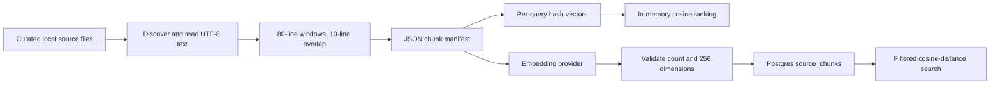
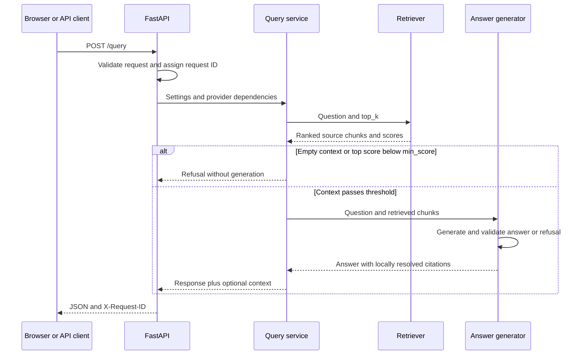
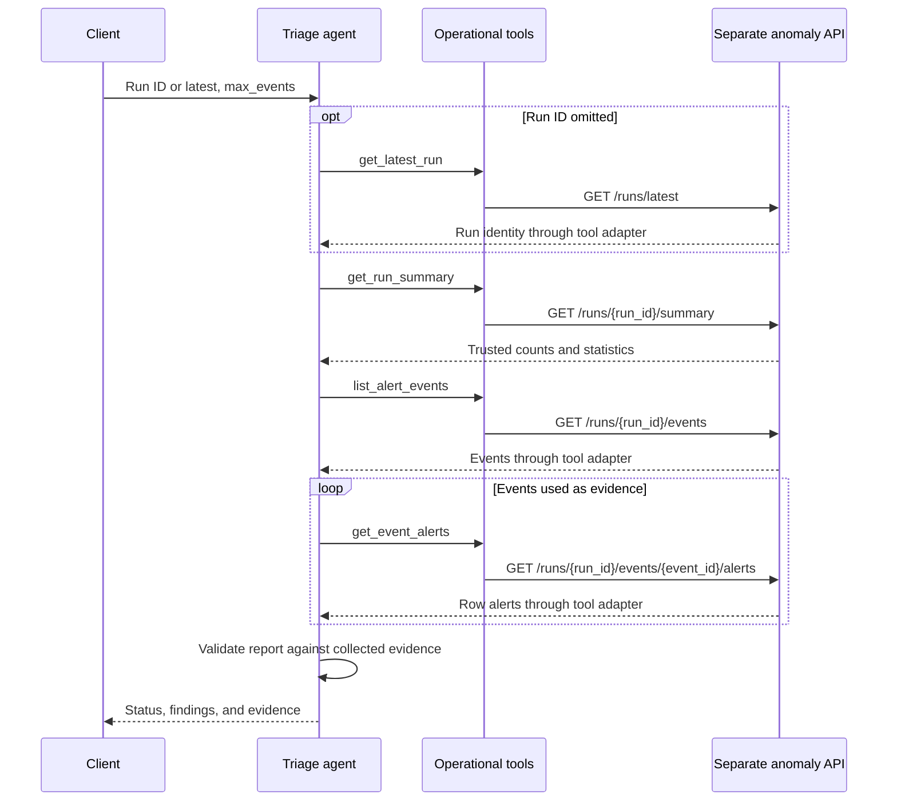

# 3. Data pipelines

[Handbook index](README.md) · Previous: [Architecture](02-architecture.md) · Next: [Contracts](04-api-and-data-contracts.md)

## Source text to searchable context

1. [`discover_source_documents`](../../copilot/ingestion/source_discovery.py) recursively selects supported files and sorts documents by source ID. It accepts `.py`, `.md`, `.txt`, `.yml`, `.yaml`, `.json`, `.toml`, `.csv`, and three Dockerfile names. It skips `.git`, `.venv`, `__pycache__`, and `.pytest_cache` path components. This is an allowlist, not a general secret scanner; use a curated root.
2. Each `SourceDocument` contains the root directory's name, relative POSIX path, type, and UTF-8 contents. IDs use `<root-name>:<relative-path>`. Reading failures propagate; there is no per-file quarantine workflow.
3. [`chunk_source_document`](../../copilot/ingestion/chunking.py) slices 80 lines at a time with 10 lines of overlap, advancing 70 lines. Lines are one-based and inclusive; chunk indices begin at zero. Empty files produce no chunks. Functions and Markdown sections may cross chunk boundaries.
4. [`write_chunk_manifest`](../../copilot/ingestion/manifest.py) creates the output directory and writes a JSON array. IDs append `#chunk-0000`, `#chunk-0001`, and so on; they are positional, not content hashes. No vectors are stored in the manifest.
5. Manifest retrieval loads this file and computes hash vectors on every request. It uses the standalone `embed_text` default of **16 dimensions**, independent of the provider setting used by database storage.
6. Database indexing embeds **chunk content only** through the configured provider. [`storage/chunks.py`](../../copilot/storage/chunks.py) checks vector count and dimensions, stores content and metadata alongside vectors, and rolls back failed database writes.

`store_chunk_manifest.py` upserts by chunk ID and leaves unrelated/stale rows in place. `reindex_embeddings.py` replaces the complete index, so it also removes chunks that disappeared from the corpus. Embeddings are prepared before deletion, and replacement occurs in one database transaction. Passing an empty manifest to replacement clears the index. Schema initialization happens separately; it is not a versioned migration system.

Renaming the corpus root changes source IDs. Editing or moving lines can keep an ID while changing its contents and citation range. Regenerate the manifest and rebuild the index together; the current semantic-evaluation preflight checks IDs/configuration, not content equality.

## Question to grounded answer

[`query_service`](../../copilot/api/query_service.py) selects one of two retrieval paths. Manifest mode computes cosine similarity over hash vectors. pgvector mode embeds the query, filters rows by provider/model/dimensions, orders by cosine distance, and limits to `top_k`. Its score is `1 - distance`; scores are similarities, not probabilities.

[`build_grounded_answer`](../../copilot/answering/grounded.py) refuses empty retrieval or a top score below `min_score`. It does **not** remove individual low-scoring chunks if the top one passes. The entire selected context reaches the generator.

The deterministic generator echoes the best chunk. The OpenAI generator sends the question and source context to `responses.parse`, requesting a `GroundedAnswerDraft`. Its instructions treat context as untrusted and restrict answers to retrieved evidence. Local checks require an answer with valid, unique citation IDs and matching inline markers, or an empty answer with a refusal reason and no citations. Citation paths and line ranges come from retrieved chunks, not model-provided paths.

The final confidence is the highest cited similarity clamped to `[0, 1]`. For a threshold refusal it is the clamped top retrieval score; an OpenAI-generated refusal returns zero. None is a calibrated estimate of factual correctness. Citation validation checks references and structure; it does not prove that every sentence is entailed by its source.

### Walkthrough: a question about SQLite tables

Request: `{"query":"Which SQLite tables store pipeline runs, predictions, and alerts?","show_context":true}`.

The correct schema is in the snapshot's `source_code/db.py`: `pipeline_runs`, `model_predictions`, `row_alerts`, and `alert_events`. With offline defaults, the reviewed corpus instead ranked `README.md:491-519` first and returned confidence approximately `0.6015`. That is a reproducible example of why a valid response shape is not evidence of useful retrieval.

Inspect `context_snippets` to see what the generator actually received. For semantic behavior, use the OpenAI/pgvector configuration and evaluate retrieved paths against labeled expectations. The committed August semantic results are historical, not a replay of this example during this review.

## Operational data to triage report

The four tools are typed adapters over [`AnomalyApiClient`](../../copilot/clients/anomaly_api.py). The client uses HTTP GET with a default five-second timeout and translates network, HTTP, JSON, and response-schema failures into typed exceptions. Copilot never writes operational records.

**Deterministic path:** [`TriageService`](../../copilot/services/triage.py) resolves a run, reads its summary, and returns `no_alerts` if the total event count is zero. Otherwise it requests critical and warning events separately, sorts the returned candidates by severity, descending anomaly score, then event ID, and takes `max_events`. It fetches each event's row alerts, checks run/machine/sensor consistency, sorts alerts by step/ID, and constructs a templated finding. It does not retrieve every severity or guarantee the highest-scoring events across all upstream pages.

**OpenAI path:** [`OpenAITriageAgent`](../../copilot/providers/openai_triage.py) asks the model for tool calls or a structured final draft. The agent tracks a resolved run, an immutable-on-repeat summary, listed events, and fetched evidence. Run-specific calls cannot change the run; alert evidence must refer to a previously listed event. Repeated conflicting results fail validation. Findings must match evidence machine, sensor, anomaly type, and derived severity. Findings and distinct evidence events are each limited by `max_events`.

The loop permits **eight tool-bearing rounds** by default. A ninth model request may return the final report; if it requests more tools, the request fails. This bounds rounds, not wall-clock time or the total number of function-call items in a response. `parallel_tool_calls=False` is sent to the model; returned calls are executed sequentially. Malformed arguments terminate the request rather than entering a repair loop. OpenAI findings retain model order; only deterministic triage explicitly sorts them.

### Walkthrough: controlled run 42

The [demo transport](../../scripts/run_demo.py) supplies a run summary and events 7 and 8. A deterministic API smoke check with `{"run_id":42,"max_events":2}` returned `completed`, two findings, and evidence IDs `event-7` and `event-8`. The deterministic finding IDs are `finding-7` and `finding-8`; the OpenAI implementation assigns positional IDs such as `finding-1` locally.

This smoke test exercised the route, tools, HTTP transport interface, and schema validation without contacting a service. A real API using the bundled upstream schema can behave differently because of the [severity mismatch](07-review-findings.md#f1-upstream-severity-filters-do-not-match-deterministic-triage).

## Failure and persistence boundaries

- `/query` does not ingest or reindex automatically. A missing manifest, incompatible dimensions, missing database, or provider failure is a request/setup failure.
- A refusal is an ordinary successful HTTP response whose payload explains insufficient support; an invalid provider response is an HTTP error.
- Operational evidence and model conversation state are per-request memory. Copilot has no conversation history, query-result database, or persisted triage reports.
- Request IDs correlate safe trace metadata across HTTP, retrieval, generation, and tool spans. They do not identify persisted business records.
- Operational data can change during triage. Repeated-result checks catch some inconsistency but do not create a database snapshot across HTTP calls.
