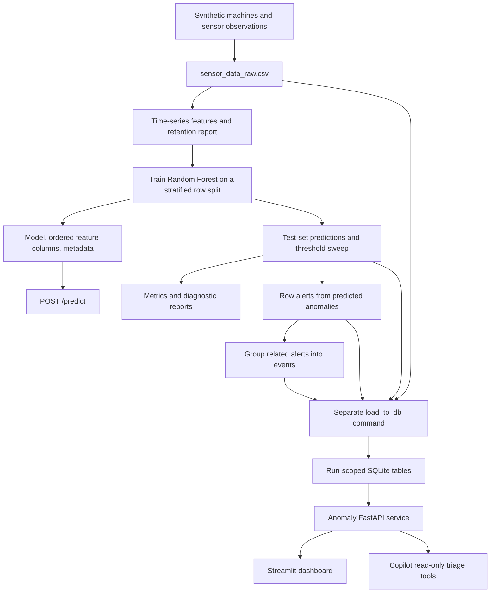

# 5. The upstream anomaly platform

[Handbook index](README.md) · Previous: [Contracts](04-api-and-data-contracts.md) · Next: [Development and operations](06-development-and-operations.md)

## What is bundled

[`data_sources/anomaly_detection_platform/`](../../data_sources/anomaly_detection_platform/) is a curated copy of code, tests, a README, and CI configuration from the anomaly platform. It is input to Copilot's source ingestion. The repository does not automatically pull upstream changes, ship trained model artifacts, or start this platform as part of the Copilot API.

The [snapshot README](../../data_sources/anomaly_detection_platform/README.md) describes the upstream project. Its commands assume the upstream project layout; in this repository, implementation files live under `source_code/` and tests are in a sibling directory. Treat this chapter as a review of that bundled version, not a statement about the current remote upstream repository or a deployed service.

## Sensor-to-alert pipeline

[`run_pipeline.py`](../../data_sources/anomaly_detection_platform/source_code/run_pipeline.py) runs generation, features, model training, evaluation, row alerts, and event grouping in order. A failed step is reported and re-raised. **Database loading is a separate command.** The pipeline is batch-oriented; there is no streaming sensor consumer in the bundled code.

| Stage | Implementation and behavior | Outputs |
| --- | --- | --- |
| Generate | [`generator.py`](../../data_sources/anomaly_detection_platform/source_code/generator.py): defaults to 10 machines, 5,000 timesteps, seed 295; simulates temperature, pressure, vibration, flow rate, voltage, current | `sensor_data_raw.csv`, including synthetic labels and targeted sensor |
| Engineer features | [`features.py`](../../data_sources/anomaly_detection_platform/source_code/features.py): per-machine deltas, rolling statistics, slopes, direction/sign-change and oscillation features; short/long windows; drops incomplete rows | `sensor_data_features.csv`, `feature_row_retention.csv` |
| Train and score | [`model.py`](../../data_sources/anomaly_detection_platform/source_code/model.py): removes labels/metadata and selected helper features, selects numeric inputs, stratifies random train/test rows, fits a Random Forest, sweeps thresholds | Test-set `predictions.csv`, `threshold_results.csv`, `feature_importance.csv`, model artifacts |
| Evaluate | [`evaluate.py`](../../data_sources/anomaly_detection_platform/source_code/evaluate.py): overall metrics and recall by anomaly type/sensor, plus diagnostic views | Printed evaluation report |
| Alert | [`alerts.py`](../../data_sources/anomaly_detection_platform/source_code/alerts.py): selects `prediction == 1`, chooses targeted sensor, applies threshold-based severity or model-score fallback | `alerts.csv` |
| Group | [`alert_events.py`](../../data_sources/anomaly_detection_platform/source_code/alert_events.py): sorts by machine/sensor/type/step and combines compatible alerts with gaps of 0–3 steps | `alert_events.csv` |
| Persist | [`load_to_db.py`](../../data_sources/anomaly_detection_platform/source_code/load_to_db.py): inserts a run, reads available CSV files, adds run IDs, and appends matching columns | SQLite database |

Synthetic anomaly types are spike, drop, drift, oscillation, stuck sensor, and impossible value. Their labels support training and evaluation; they are not an inference mechanism that Copilot adds.

The model's default threshold is 0.35, random state 42, and test fraction 0.2. The threshold sweep generates predictions only for held-out test indices. Consequently downstream alerts/events describe that scored subset rather than every generated observation. The split is random across rows, not chronological or machine-held-out; generalization to future operational periods is not established by that evaluation.

Feature code groups rolling computations by machine but contains a discarded `sort_values` result. It currently depends on incoming row order being appropriate; see [findings](07-review-findings.md#f10-bundled-feature-builder-discards-its-sort-result).

## How events retain meaning

A row alert identifies a run, alert ID, machine, sensor, step, value, anomaly score, severity, and reason. Model-predicted anomalies are the entry point: a threshold violation on a row not selected by `prediction == 1` does not independently create an alert in this implementation.

An event groups alerts for the same machine, sensor, and anomaly type within the configured step gap. It records the start/end steps, inclusive duration, count, highest severity/reason, max/mean anomaly score, min/max sensor value, and first reason. Event and alert IDs restart within generated outputs, so SQLite keys include `run_id`.

[`db.py`](../../data_sources/anomaly_detection_platform/source_code/db.py) creates these tables:

| Table | Role and identity |
| --- | --- |
| `pipeline_runs` | Auto-increment run ID, creation time, notes and generation/model metadata |
| `sensor_readings` | Auto-increment reading ID plus run ID and sensor observations |
| `model_predictions` | Auto-increment prediction ID plus run ID, step, machine, scores/labels |
| `row_alerts` | Composite primary key `(run_id, alert_id)` |
| `alert_events` | Composite primary key `(run_id, event_id)` |

Foreign keys point to `pipeline_runs`; `get_connection` enables foreign-key enforcement. Query indexes cover common run, severity, sensor, anomaly type, step and machine filters. There is no event-to-row-alert foreign key. [`get_row_alerts_for_event`](../../data_sources/anomaly_detection_platform/source_code/db_queries.py) reconstructs membership from run, machine, sensor, anomaly type and inclusive step interval.

Loading is not all-or-nothing across the run: the loader commits the run and individual table loads, and skips missing/empty input files. A run can therefore exist with partial data. Do not equate “latest run exists” with “all pipeline artifacts loaded successfully.”

## Saved model and prediction API

Training writes `model.joblib`, `feature_columns.json`, and `model_metadata.json` to the artifact directory. [`model_serving.py`](../../data_sources/anomaly_detection_platform/source_code/model_serving.py) reloads them for prediction, builds a one-row DataFrame, fills missing expected features with zero, reorders columns to the saved feature order, and applies the saved threshold to `predict_proba`.

`POST /predict` accepts a `features` mapping of precomputed feature values. It does not transform a raw sensor observation into the rolling feature history. Model artifacts and compatible feature engineering are required for meaningful predictions. Copilot's four operational tools do not call `/predict`.

## API and dashboard boundary

[`api.py`](../../data_sources/anomaly_detection_platform/source_code/api.py) exposes health, run listing/latest/summary, filtered events and predictions, row alerts for an event, machine readings, distributions, a combined dashboard response, and model prediction. [`db_queries.py`](../../data_sources/anomaly_detection_platform/source_code/db_queries.py) performs parameterized data queries. [`dashboard.py`](../../data_sources/anomaly_detection_platform/source_code/dashboard.py) uses HTTP to fetch dashboard aggregates and renders Streamlit metrics, distributions, and critical-event views.

Copilot only needs four read endpoints described in [the tool contracts](04-api-and-data-contracts.md#operational-tool-contracts). It neither loads upstream CSVs nor opens SQLite itself.

**Compatibility issue:** the snapshot writes `CRITICAL`, `WARNING`, and `INFO`; event-filter SQL compares exact strings. Deterministic Copilot sends `critical` and `warning`, which return no matching events. This was reproduced with the bundled SQLite query functions. Do not assume a successful mock demo proves compatibility with this upstream version. A future fix needs an agreed severity contract and a cross-boundary test.

## Running the upstream separately

For normal development, use a separate upstream checkout and its own environment, requirements, outputs, and artifacts. Its dependency list includes the ML/dashboard dependencies that Copilot's package does not install. If exploring the bundled copy, run from its `source_code/` directory in a separate virtual environment; relative output paths assume that working directory. Create `outputs/` first. Do not run the upstream scripts as part of Copilot ingestion.

The upstream sequence is `python run_pipeline.py`, then `python load_to_db.py`, then `python -m uvicorn api:app --host 127.0.0.1 --port 8001`. For the separate dashboard process, set `API_BASE_URL=http://127.0.0.1:8001` and run `streamlit run dashboard.py`. Keep Copilot on port 8000 and point its `ANOMALYOPS_ANOMALY_API_BASE_URL` at port 8001. This review inspected the upstream implementation and reproduced targeted behavior; it did not train the model or launch the upstream UI/API.

Upstream configuration uses `DB_PATH`, `API_BASE_URL`, `MODEL_THRESHOLD`, `RANDOM_STATE`, `TEST_SIZE`, `OUTPUT_DIR`, and `ARTIFACT_DIR`. Some scripts still hardcode `outputs/...`, so changing `OUTPUT_DIR` alone does not relocate the entire pipeline. These settings belong to the upstream process and are separate from Copilot's `ANOMALYOPS_*` variables.
